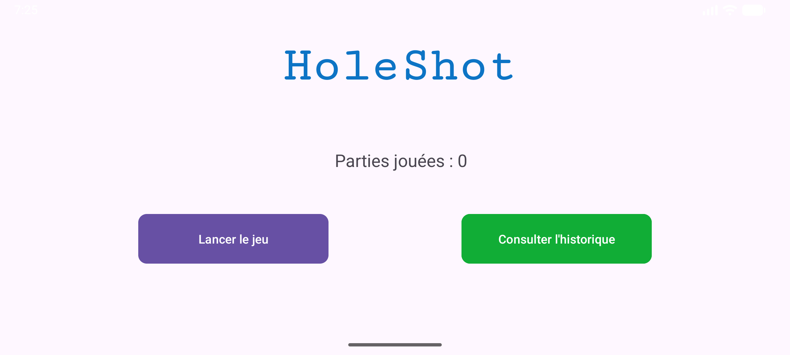
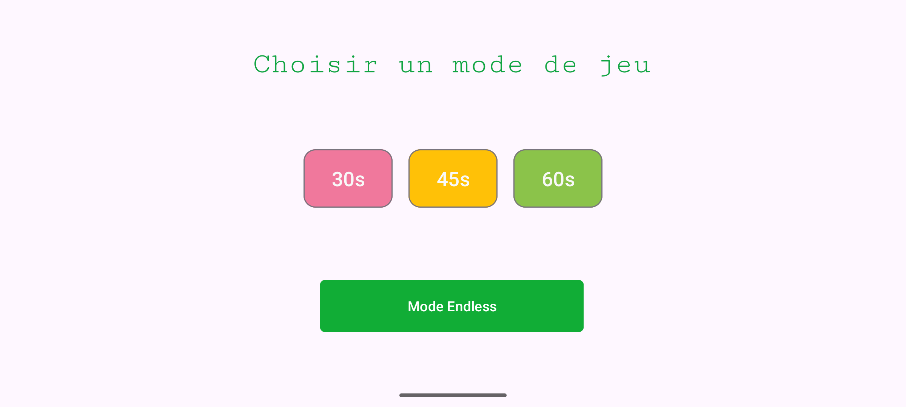
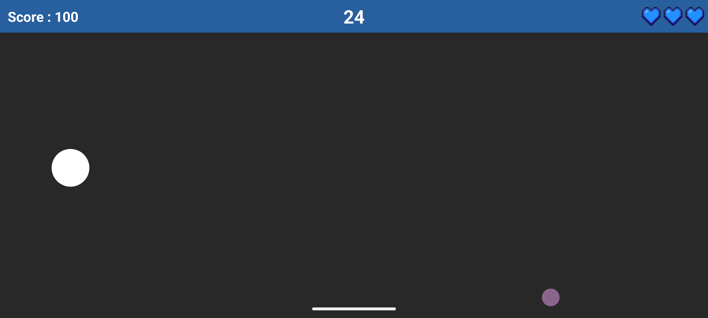
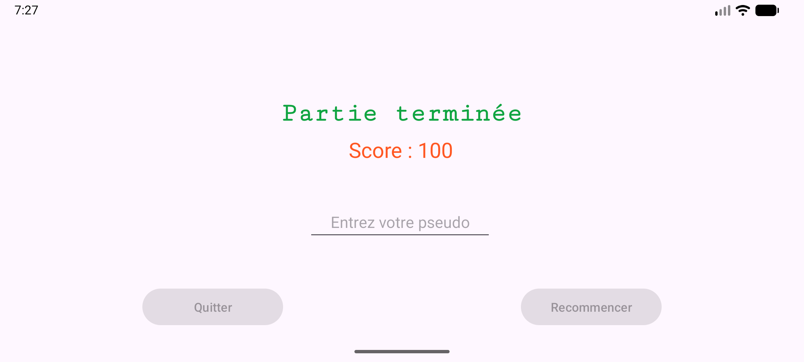

# HoleShot

HoleShot est un mini-jeu mobile Android développé dans le cadre d'un projet
scolaire réalisé à deux. Le projet avait pour objectif de découvrir les
interactions propres aux appareils mobiles, en particulier l'utilisation des
capteurs intégrés au téléphone et la conception d'une interface adaptée à un
jeu en mode paysage.

## Principe du jeu

Le joueur contrôle une boule en inclinant son téléphone : l'accéléromètre
transforme les mouvements de l'appareil en déplacements à l'écran. Il doit
faire entrer la boule dans le trou affiché dans l'aire de jeu. À chaque
réussite :

- le score augmente ;
- le trou est déplacé aléatoirement ;
- sa taille est renouvelée ;
- des obstacles peuvent apparaître progressivement.

Les obstacles bloquent la boule et font perdre une vie en cas de collision.
Une courte période d'invincibilité suit chaque choc, signalée par le
clignotement de la boule. La partie se termine lorsque le temps est écoulé ou
lorsque les trois vies sont perdues. Le but est de réaliser le meilleur score
possible.

## Modes de jeu

Depuis l'écran de sélection, quatre modes sont disponibles :

| Mode | Fonctionnement |
| --- | --- |
| **30 s** | Marquer un maximum de points en 30 secondes. Les réussites rapportent 300 points multipliés par le nombre de trous déjà atteints. |
| **45 s** | Marquer un maximum de points en 45 secondes, avec 200 points par multiplicateur. |
| **60 s** | Marquer un maximum de points en 60 secondes, avec 100 points par multiplicateur. |
| **Endless** | Jouer sans durée fixe : le compte à rebours repart à chaque trou atteint. Le nombre de points et la taille des obstacles augmentent progressivement. |

Dans tous les modes, la difficulté évolue au fil des réussites : les
obstacles sont générés de manière aléatoire et leur apparition dépend de la
progression de la partie.

## Interface utilisateur

L'application est pensée pour une utilisation en paysage et propose un
parcours simple, organisé en cinq écrans.

### Menu principal

L'écran d'accueil présente le titre **HoleShot**, le nombre de parties déjà
jouées et deux actions clairement séparées :

- **Lancer le jeu**, qui ouvre le choix du mode ;
- **Consulter l'historique**, qui ouvre le classement.



### Choix du mode

L'écran de sélection utilise des boutons colorés et de grande taille pour
rendre les durées immédiatement lisibles. Les modes chronométrés (**30 s**,
**45 s** et **60 s**) sont regroupés au centre, tandis que le bouton **Mode
Endless** est placé en dessous et occupe davantage d'espace. Cette
organisation distingue les parties à durée fixe du mode sans fin.



### Écran de jeu

La partie se déroule dans une zone de jeu volontairement épurée. Une barre
d'informations bleue reste visible en haut de l'écran et affiche :

- le score à gauche ;
- le temps restant au centre ;
- les trois vies sous forme de cœurs à droite.

La zone de jeu affiche la boule, le trou et les obstacles. Le contraste
s'adapte automatiquement au capteur de luminosité : dans un environnement
sombre, le fond devient foncé, les obstacles deviennent bleus et le trou est
affiché en clair ; dans un environnement lumineux, le fond est clair et le
trou utilise son visuel dédié. Le bouton de retour est désactivé pendant la
partie afin d'éviter une sortie accidentelle.



### Fin de partie

L'écran de résultat rappelle que la partie est terminée et affiche le score
obtenu. Le joueur peut saisir un pseudo (15 caractères maximum). Les boutons
**Quitter** et **Recommencer** restent désactivés tant qu'aucun pseudo n'est
renseigné, ce qui guide la saisie et évite d'enregistrer un résultat incomplet.
Le score est ensuite envoyé au classement en ligne.



### Historique et classement

L'écran **TOP 10 JOUEURS** affiche les dix meilleurs scores, tous joueurs
confondus, dans une liste défilante. Un bouton **Menu principal** permet de
revenir à l'accueil. Le nombre de parties jouées est conservé localement,
tandis que les scores et les pseudos sont enregistrés dans une base Supabase
accessible via l'API REST.

## Technologies et architecture

- **Android** avec une configuration Gradle Kotlin DSL ;
- **Java** pour les activités et la logique du jeu ;
- **Android Views / XML** pour les écrans et la mise en page ;
- `SurfaceView` et une boucle dédiée à 60 FPS pour le rendu de la partie ;
- capteurs **accéléromètre** et **luminosité** ;
- `SharedPreferences` pour le compteur local de parties ;
- **Supabase** pour l'enregistrement et la récupération du TOP 10 ;
- AndroidX AppCompat, Material et ConstraintLayout pour les composants d'interface.

Les principaux écrans sont répartis dans les activités suivantes :

- `MainActivity` : menu principal ;
- `ModeActivity` : sélection du mode ;
- `GameActivity` et `GameView` : partie et rendu temps réel ;
- `ResultActivity` : score final et enregistrement ;
- `HistoriqueActivity` : classement.

## Installation et lancement

1. Cloner le dépôt :

   ```bash
   git clone https://github.com/JayroZeppely/HoleShot.git
   cd HoleShot
   ```

2. Ouvrir le projet dans Android Studio.
3. Synchroniser Gradle.
4. Lancer l'application sur un appareil ou un émulateur Android en paysage.

Le projet cible Android 36 et prend en charge les appareils à partir d'Android
27. Pour une expérience complète, l'appareil doit disposer d'un accéléromètre
et d'un capteur de luminosité.

## Contexte du projet

Ce projet scolaire a été réalisé en binôme. Il nous a permis de mettre en
pratique la navigation entre activités, la création d'une interface mobile
lisible, la gestion d'une boucle de jeu, l'utilisation des capteurs Android et
la persistance des scores.
